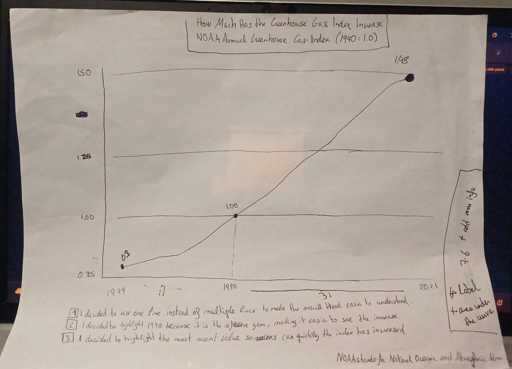

| [Home](https://jbejaran-bit.github.io/Javier_Bejarano_Telling_Stories_with_Data/) | [Data viz examples](dataviz-examples) | [Critique by design](critique-by-design) | [Final project I](final-project-part-one) | [Final project II](final-project-part-two) | [Final project III](final-project-part-three) |

# Critique and Redesign: NOAA's Greenhouse Gas Index

## Step 1: Original visualization

**Original source:** [NOAA Annual Greenhouse Gas Index (AGGI)](https://gml.noaa.gov/aggi/aggi.html) (see the AGGI visualizations on the NOAA page).

I selected NOAA's greenhouse gas index because I wanted to better understand how the warming influence of long-lived greenhouse gases has changed. I was interested in comparing recent years with 1990 rather than trying to explain all greenhouse gas measurements at once. The NOAA visualization contains useful scientific information, but I wanted to make its main message understandable to someone without a scientific background.

NOAA uses 1990 as the reference year, with an index of 1.00. A value of around 1.56 in 2025 means the warming influence measured by this index is around 56% higher than in 1990. It **does not** mean Earth's temperature has increased by 56%.

## Step 2: Critique of the original chart

One strength of the original NOAA visualization is the amount of historical context it provides. It helps readers see how different greenhouse gases contribute to the overall warming influence, and the scientific source is clearly identified.

I think it is harder for a general audience to understand the main comparison immediately because it includes several measurements and more than one vertical scale. A reader has to decide which line and which axis matter for the question they are trying to answer. The intended audience could include scientists, policymakers, students, and readers interested in climate change, but those groups may need different levels of detail.

My redesign focuses on one question: how much higher is the overall greenhouse gas index than it was in 1990? The original is more useful for examining several related measurements, while my simpler chart is more useful for communicating this particular comparison.

**Stephen Few's evaluation form:** [Course critique form](https://forms.gle/cKLcf5prjyzXJX9x9) — complete separately as required by the assignment.

### Reflecting on Stephen Few's method and the Good Charts matrix

I found Stephen Few's Data Visualization Effectiveness Profile useful because it made me evaluate individual aspects of the NOAA chart, such as completeness, perceptibility, and intuitiveness, instead of simply deciding whether I liked the design. For example, I rated the chart highly for usefulness and completeness because it provides valuable scientific context, but lower for perceptibility and intuitiveness because the multiple lines and two vertical scales take longer to understand.

The *Good Charts* matrix takes a broader approach by considering design execution and contextual awareness. I think it is useful for asking whether a chart fits its audience and purpose, while Few's profile helps me identify exactly which qualities need improvement. One limitation of scoring either method is that a number alone cannot explain the reasoning behind a design choice. I found it more useful to explain why I gave a score and how that observation influenced my redesign.

For this project, both approaches pointed me toward the same decision: keep the original scientific source and historical context available, but build a simpler chart for readers who mainly want to understand the increase relative to 1990.

## Step 3: Paper sketch and initial design

I began with a hand-drawn line chart showing the greenhouse gas index from 1979 onward. My three intended changes were:

1. Focus on one overall index line rather than the multiple measurements in the source visualization.
2. Emphasize 1990 = 1.00 as the reference, so readers understand what the index values mean.
3. Label the latest value so the size of the increase is clear without requiring readers to estimate it from the axis.

**Paper-sketch photo:** 

## Step 4: Test the solution — feedback from classmates

I shared my hand-drawn sketch with three classmates in our in-class critique. We discussed the same design together, and all three agreed with the main suggestions below. I have organized the shared feedback into three anonymous student entries by topic, rather than treating them as exact individual quotations.

### Questions we considered

- What is the main message you see without an explanation?
- Are the numbers, labels, and units understandable?
- What would you change to draw attention to the most important value?
- Should the redesign show more information, or would that make it harder to read?

### Feedback collected

**Student 1 — Title and labels**

The title should explain more clearly what the chart is showing. The values and units also need to be understandable to someone unfamiliar with NOAA data. We discussed an unclear number on the sketch and why readers should not have to guess what a number represents.

**Student 2 — Color and focus**

Color could help readers follow the overall trend and identify the main takeaway. The group also suggested removing the dot at the beginning of the line so that attention would go to the current dot and the size of the increase.

**Student 3 — Information and audience**

We considered adding more lines, like those in the original NOAA visualization, to give additional context. However, we also agreed that someone unfamiliar with the topic could find too many lines confusing. The design should answer one clear question before adding more detail.

### What I learned and changed

The feedback made me realize that even if I understand a chart, its message may not be obvious to someone seeing the data for the first time. I changed the headline to focus on the increase since 1990, made the reference value of 1.00 more visible, and labeled the most recent index value of approximately 1.56 in 2025. I used blue for the trend and orange for the reference line to create a clearer visual hierarchy.

I also considered the suggestion to remove the first dot so the latest point would stand out more. I wanted the focus to be on the current value rather than giving equal attention to the beginning and end of the series. I chose not to add more gas-specific lines because my question is about the overall index, not the separate contributions of each gas. This keeps the final chart simpler than NOAA's original while making the 1990 comparison easier to interpret.

## Step 5: Final visualization

### How Much Has the Greenhouse Gas Index Increased Compared with 1990?

<iframe title="NOAA greenhouse gas index redesign" aria-label="Line chart showing the NOAA greenhouse gas index from 1979 to 2025" id="datawrapper-chart-LfzIX" src="https://datawrapper.dwcdn.net/LfzIX/1/" scrolling="no" frameborder="0" style="width: 100%; min-width: 100% !important; border: none;" height="430" data-external="1"></iframe>

[Open the published Datawrapper chart](https://datawrapper.dwcdn.net/LfzIX/1/)

I made the final visualization in Datawrapper using annual NOAA AGGI data. The line shows the overall pattern across time. I added the horizontal reference line at 1.00 and marked 1990 to show where the comparison begins. The 2025 annotation identifies the index of approximately 1.56 and the 56% increase relative to 1990.

I chose not to fill the area below the line because the main point is the **change relative to the reference year**, not the accumulated area. I kept the trend line blue and used orange for the baseline so the comparison stands out. The result is intentionally narrower than NOAA's original chart: it sacrifices some scientific detail in exchange for a quicker, clearer answer to one question.

## Sources

- [NOAA Global Monitoring Laboratory — Annual Greenhouse Gas Index](https://gml.noaa.gov/aggi/aggi.html)
- [Final visualization created with Datawrapper](https://datawrapper.dwcdn.net/LfzIX/1/)

## AI acknowledgement

I used ChatGPT to help understand the assignment instructions and troubleshoot visualization settings.
