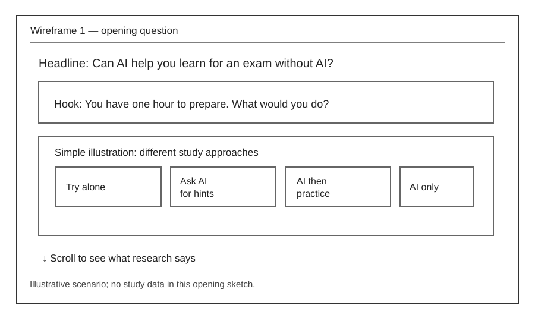
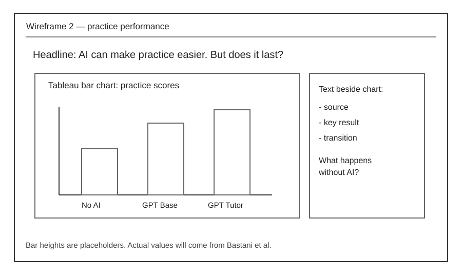
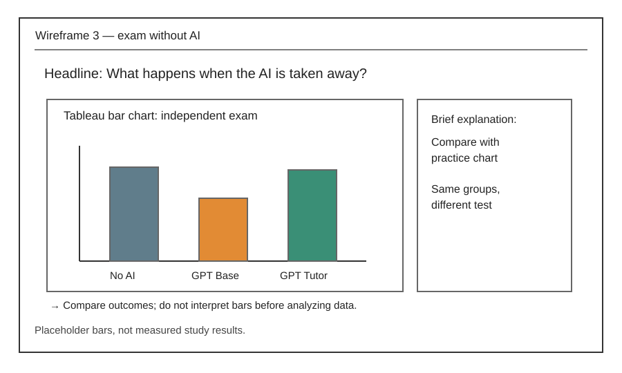
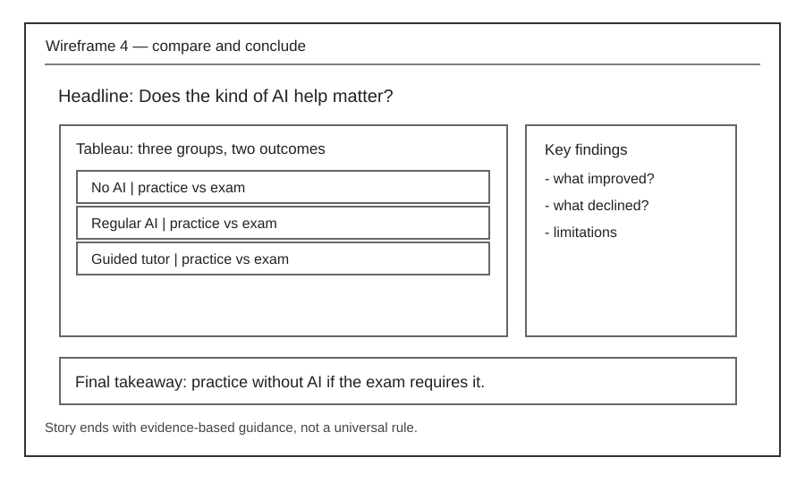
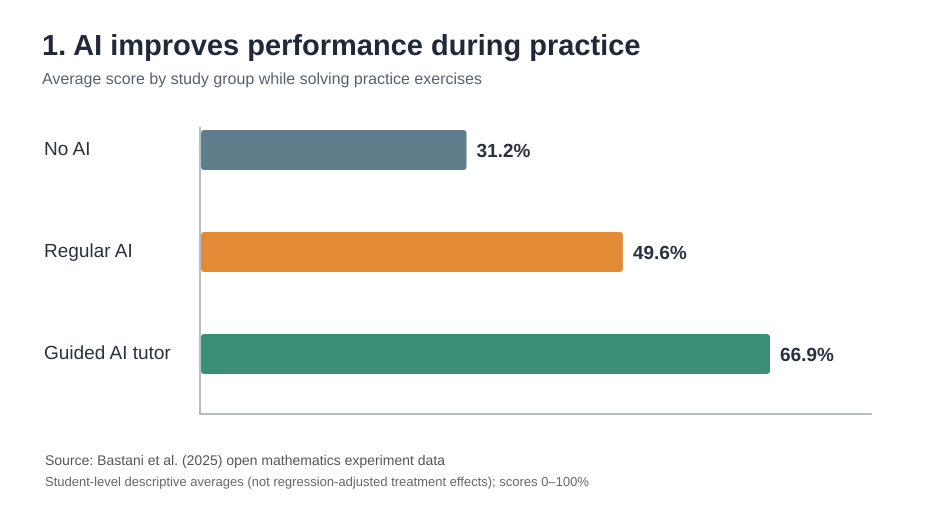
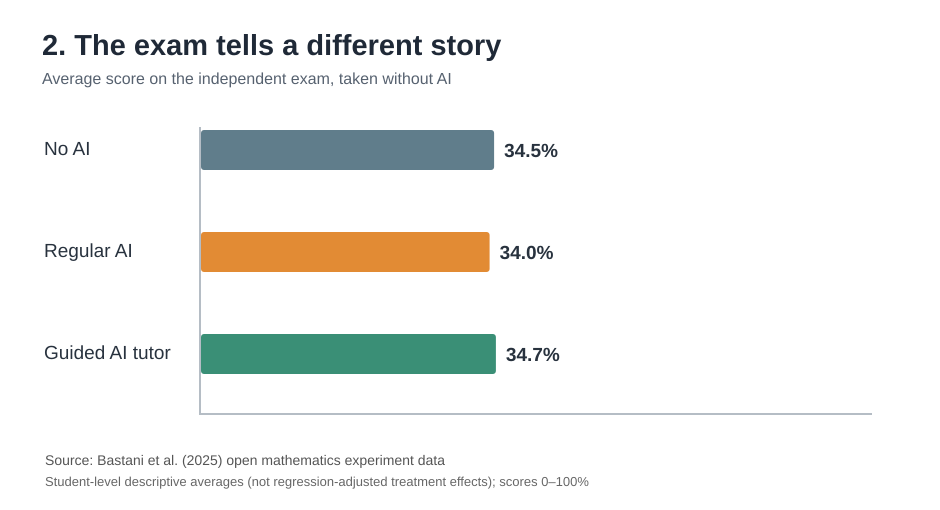
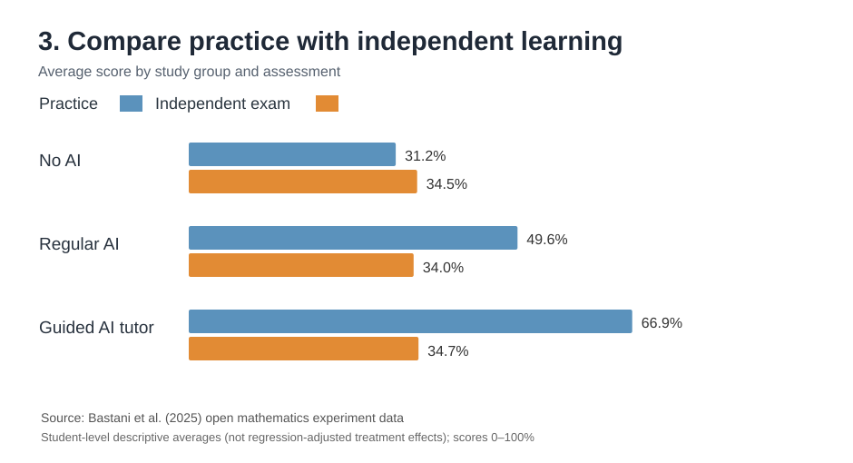

| [Home](https://jbejaran-bit.github.io/Javier_Bejarano_Telling_Stories_with_Data/) | [Data viz examples](dataviz-examples) | [Critique by design](critique-by-design) | [Final project I](final-project-part-one) | [Final project II](final-project-part-two) | [Final project III](final-project-part-three) |

# Final Project — Part I: Outline, Data, and Sketches

## AI: Making Us Smarter or More Dependent?
### Does AI help students learn when they have to work without it?

## 1. Project outline

### High-level summary

I chose this topic because it is something I wonder about as a student. Sometimes I struggle to follow lectures, but when I study using AI as my tutor, I can ask questions, get explanations, and practice exercises similar to an exam. I also wonder whether using AI to finish an assignment faster actually helps me learn or just helps me complete the work.

I want to compare **performance with AI** and **learning without AI**. Using a public mathematics experiment, I will explore whether students who do better during practice also do better when they have to solve problems independently. The goal is not to say AI is always good or bad, but to help students think about how to use it when studying.

### Audience and story

My main audience is college students who use AI for assignments and exam preparation. Professors may also find the results interesting. The central question is: **What happens when AI is taken away?**

The story will follow three steps:

| Story stage | What I want to show | Planned Tableau chart |
| --- | --- | --- |
| **Setup — AI helps with practice** | Does AI improve scores while students are using it? | Practice scores for the three experimental groups |
| **Conflict — Take AI away** | Do students still perform well on an independent exam? | Independent exam scores for the same groups |
| **Resolution — The type of help matters** | Are the results different with unrestricted AI versus a guided AI tutor? | Comparison of the three groups across both outcomes |

I will introduce the story with a **hypothetical student deciding how to spend one hour studying**, then finish with a few practical takeaways. The three main charts will come from **Bastani et al.'s mathematics experiment**, using Tableau. I will connect them in a short scrolling story using Shorthand.

The original sketches below show several ideas I considered. I do **not** need to turn all six into final charts. The Harvard physics and Anthropic programming studies can provide brief context if useful, but the mathematics study will be my main evidence.

**Important limitation:** The one-hour scenario is an example, not an experiment. The data cannot prove the best number of minutes to use AI or whether students should skip lectures. I will keep these distinctions clear and label all research findings with their sources.

## 2. Initial sketches and storyboard

These are **simple digital wireframes** showing how I plan to organize the story. I used basic boxes, chart placeholders, headings, and notes instead of polished charts. The final charts will be created in Tableau using the research data. The bar heights in the sketches are **not real results**.

### Sketch 1 — Opening question

I want to start with a relatable question: if you have one hour before an exam, how should you use it? The four possible approaches are examples, not study groups. This will be a short introduction in **Shorthand**.

### Sketch 2 — Practice with AI

The first **Tableau** chart will compare practice scores for the no-AI group, regular GPT group, and guided tutor group from [Bastani et al. (2025)](https://doi.org/10.1073/pnas.2422633122). I will use the actual scores after checking the data.

### Sketch 3 — Exam without AI

The second **Tableau** chart will compare those groups on their independent exam, using the same colors and layout as the previous chart. I want readers to see the difference between doing well during practice and learning enough to work alone.

### Sketch 4 — Comparing types of AI and ending the story

My third **Tableau** chart will help compare the three groups across practice and exam performance. I will finish in **Shorthand** with a short explanation of what the findings mean for students, without claiming one strategy is always best.

### Preliminary charts using the research data

I also created three simple **color charts from the actual student-level research CSV**, to test the comparisons I want to communicate in the final story. These are preliminary data visualizations, **not Tableau screenshots**. The finished story can recreate and refine them in Tableau.

**Chart 1: Practice performance**

**Chart 2: Independent exam performance**

**Chart 3: Practice versus independent exam**

The original public file has multiple session records per student. For these descriptive charts, I averaged each student's available session scores first and then averaged across students in each experimental group. Results are **unadjusted descriptive group means**, not estimates of the causal effect reported by the study.

## 3. The data

### Primary dataset 1: high-school mathematics experiment

My main quantitative dataset comes from [**Bastani et al. (2025), _Generative AI without guardrails can harm learning_**](https://doi.org/10.1073/pnas.2422633122), a randomized study of nearly 1,000 high-school mathematics students. The students were assigned to conditions with no AI, regular GPT-4 assistance, or a more carefully designed GPT tutor. They completed practice problems and then an independent test. The researchers provide the data and code publicly. I checked the repository and located the actual CSV containing student/session observations.

The data contains variables including `Part2Tot` (practice score), `Part3Tot` (independent exam score), `GPTBase`, `GPTTutor`, `Treatment arm`, prior GPA, and self-reported weekday/weekend study hours. I plan to compare the randomized groups on practice and independent-test results, clearly labeling those as different outcomes. The study-hour variables are especially relevant to my hypothesis, but those hours are **self-reported background measures**, not a randomized “time spent with AI” treatment. I will not claim that spending fewer hours caused lower exam scores.

**Tableau-ready data:** [Download student-level summary CSV](data/ai-math-tableau-student-summary.csv). I prepared one row per student from the original file by averaging each student's available session scores. The dataset has 943 participants across three study groups. I removed the original student ID and provided scores as percentages to make Tableau comparisons easier. These are **simple descriptive averages**, not the paper's regression-adjusted treatment estimates.

**Public working data:** [Download the main CSV](https://raw.githubusercontent.com/obastani/GenAICanHarmLearning/main/main_regressions/final_data.csv) · [Open the data file on GitHub](https://github.com/obastani/GenAICanHarmLearning/blob/main/main_regressions/final_data.csv) · [Data dictionary and analysis code](https://github.com/obastani/GenAICanHarmLearning).

### Optional supporting dataset: Harvard physics AI-tutor experiment

My second primary dataset comes from [**Kestin et al. (2025), _AI tutoring outperforms in-class active learning_**](https://doi.org/10.1038/s41598-025-97652-6). This randomized study compared a purpose-built AI tutor with in-person active-learning instruction in a university physics course. It is useful because it measures learning, rather than merely whether students can finish a task faster. It provides evidence that a well-designed AI tutor can sometimes lead to better learning in less time in the setting studied. I located the public Stata dataset (`.dta`) in the research team's repository.

If time permits, I could compare the groups' learning outcomes within that experiment. I will also show the reported time comparison, while separating actual time on task from scheduled classroom time. If the public file does not contain every time measure I need, I will use the study's explicitly published aggregate numbers and label them as reported results. This experiment does not tell us that all lectures are ineffective, or that students should skip classes.

**Public working data:** [Download the Stata data file](https://raw.githubusercontent.com/HarvardAItutor/Study-Data-v4/main/Harvard_AI_Tutor_Study_Data.dta) · [Open the dataset repository](https://github.com/HarvardAItutor/Study-Data-v4) · [Read the paper](https://doi.org/10.1038/s41598-025-97652-6).

### Supporting studies and assembled data

I also plan to use two additional studies as context. [**Anthropic's 2026 coding-skills experiment**](https://www.anthropic.com/research/AI-assistance-coding-skills) compared AI-assisted programmers with programmers working without AI. The published report states that average scores on an independent skills quiz were 50% with AI versus 67% without AI, while the average task-time advantage of AI was not statistically significant. Its exploratory interaction categories are especially relevant to my question about *how* students use AI, but those categories were not randomly assigned. [**Smerdon (2024)**](https://doi.org/10.1016/j.caeai.2024.100288) studied permitted AI usage on an undergraduate research-proposal assignment and found no clear average grade advantage for AI users. This is observational evidence, so I will not describe it as a causal experiment.

**Another relevant study:** [Liu et al. (2026), a university AI-tutoring trial](https://scale.stanford.edu/ai/repository/effects-course-integrated-ai-tutoring-student-performance-and-engagement-randomized-university-trial), looked at 2,379 students. In that study, access to an AI tutor reduced participation in other course activities and did not improve academic performance. I may mention it when discussing whether AI can replace rather than support studying. I will use its published findings only, since I have not confirmed access to its student-level data.

I created a small, sourced [CSV of published results](data/ai-learning-published-results.csv) so the numbers for initial charts are available in my portfolio. It is a manually assembled table of statistics reported by the studies, **not the studies' original participant-level dataset**. I will use the two public primary datasets above for original analyses and these published results for context. Different studies involve different populations, tasks, and assessments, so their scores should not be pooled into one ranking.

### Data source inventory

| Source | Evidence I want to use | Actual data access |
| --- | --- | --- |
| [Bastani et al., 2025 — mathematics](https://doi.org/10.1073/pnas.2422633122) | Assisted practice, independent exam, study habits, AI condition | [Public CSV](https://raw.githubusercontent.com/obastani/GenAICanHarmLearning/main/main_regressions/final_data.csv) |
| [Kestin et al., 2025 — university physics](https://doi.org/10.1038/s41598-025-97652-6) | AI tutoring versus active class, learning, time | [Public Stata dataset](https://github.com/HarvardAItutor/Study-Data-v4/blob/main/Harvard_AI_Tutor_Study_Data.dta) |
| [Anthropic, 2026 — programming skills](https://www.anthropic.com/research/AI-assistance-coding-skills) | Quiz scores, task time, ways of interacting with AI | Published aggregate results; [sourced values CSV](data/ai-learning-published-results.csv) |
| [Smerdon, 2024 — research proposal](https://doi.org/10.1016/j.caeai.2024.100288) | Whether AI use is associated with better assignment grades | Published study findings; not counted as a participant-level dataset |

### Why the data is enough for this proposal

I already have links to two public datasets I can analyze: the mathematics experiment CSV and the Harvard physics experiment data. I also have a small CSV with reported results from the other studies. I will use the mathematics dataset for the three main charts and keep the Harvard dataset as an optional extension rather than committing to another full analysis. The supporting studies will help explain why results can differ, but I will not compare scores across different tests as if they were directly equivalent.

## 4. Method and medium

I plan to make a short, interactive data story in **Shorthand** using **three Tableau charts**. I will use the public mathematics experiment CSV to compare practice performance, independent exam results, and different types of AI assistance. Each chart will answer one question, with a short explanation before moving to the next part of the story.

I will open the CSV directly in **Tableau Public**, check how the student and session records are organized, and calculate the group comparisons there. Because some students have multiple rows, I will make sure they are not incorrectly counted more than once. I will use clear labels, consistent colors, and source notes. **Python is not part of my planned workflow**; I would only use it if the data cannot be prepared accurately in Tableau.

### Simple workflow

1. Open the [Tableau-ready student summary CSV](data/ai-math-tableau-student-summary.csv) in Tableau Public.
2. Check the student IDs, study groups, and scores so the comparisons are accurate.
3. Create and publish three Tableau charts.
4. Embed the charts in a Shorthand story with a short introduction and conclusion.
5. Review the charts and improve them using feedback.

**Why this project is feasible:** I have access to the main dataset, and I can create the visualizations using tools we have learned in class. I do not need to conduct my own experiment or analyze several different datasets.

## 5. What I still need to investigate

- Whether the Harvard raw file includes the time variable at the level needed for the planned comparison. The published paper also reports time-on-task results that I can use.
- Whether there is enough time information in the mathematics study to discuss active engagement without confusing it with self-reported study hours.
- How to make the final student decision guide useful without overstating what any single experiment proves.
- How to present different populations (high-school students, university students, and professional developers) clearly instead of treating them as interchangeable.

## References

1. Bastani, H., Bastani, O., Sungu, A., Ge, H., Kabakcı, Ö., & Mariman, R. (2025). *Generative AI without guardrails can harm learning: Evidence from high school mathematics.* Proceedings of the National Academy of Sciences. https://doi.org/10.1073/pnas.2422633122
2. Kestin, G., Miller, K., Klales, A., Milbourne, T., & Ponti, G. (2025). *AI tutoring outperforms in-class active learning: An RCT introducing a novel research-based design in an authentic educational setting.* Scientific Reports. https://doi.org/10.1038/s41598-025-97652-6
3. Anthropic. (2026, January 29). *How AI assistance impacts the formation of coding skills.* https://www.anthropic.com/research/AI-assistance-coding-skills
4. Smerdon, D. (2024). *AI in essay-based assessment: Student adoption, usage, and performance.* Computers and Education: Artificial Intelligence. https://doi.org/10.1016/j.caeai.2024.100288
5. Liu, J., et al. (2026). *The effects of course-integrated AI tutoring on student performance and engagement: A randomized university trial.* EdWorking Papers. https://doi.org/10.26300/y3f8-vh05
