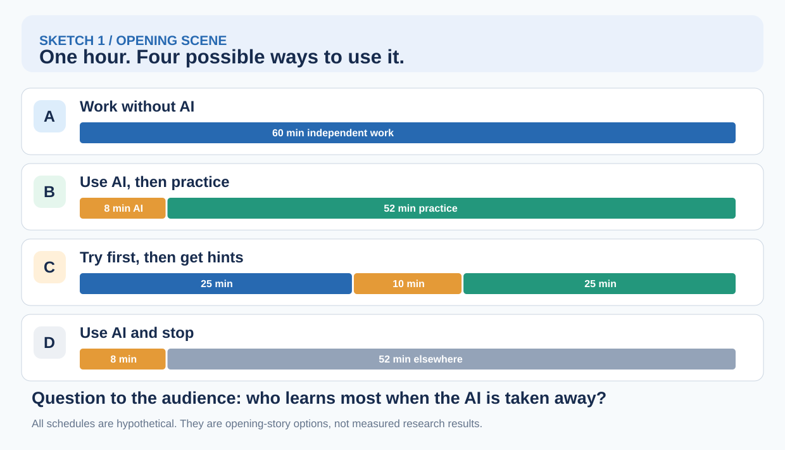
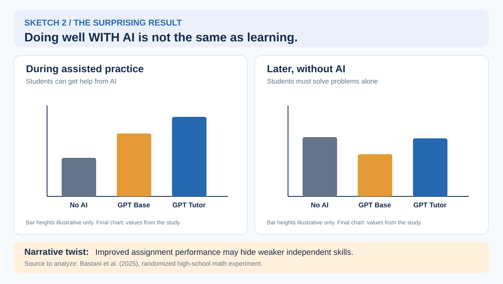
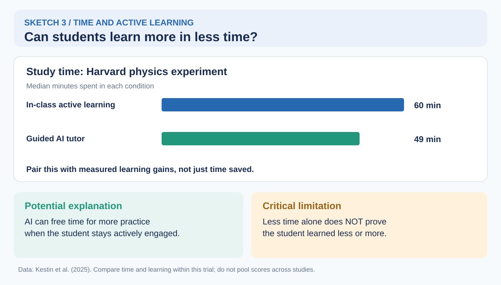
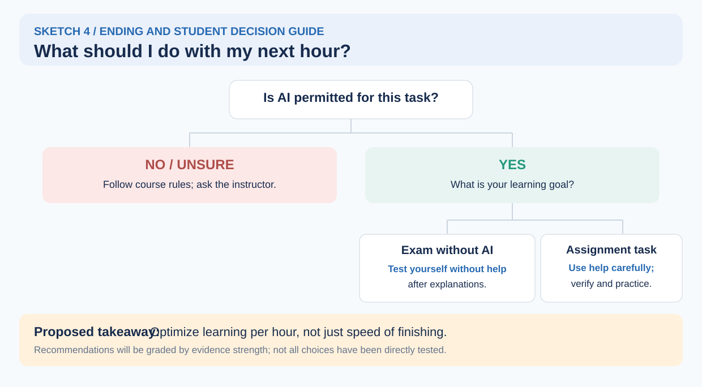
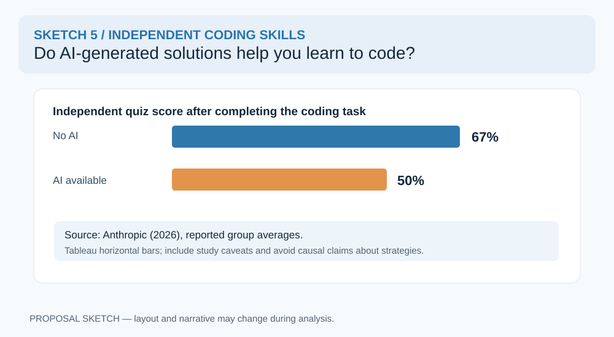
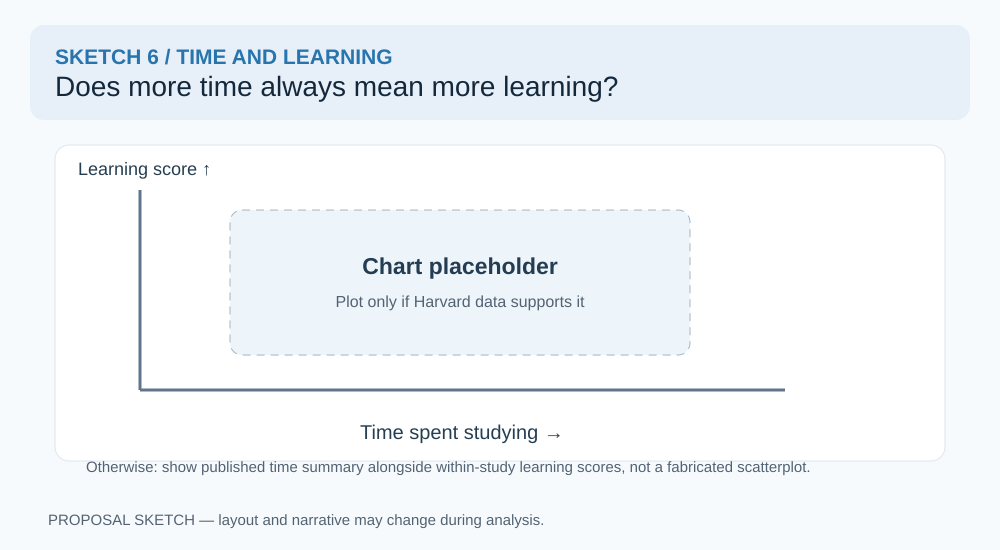

| [Home](https://jbejaran-bit.github.io/Javier_Bejarano_Telling_Stories_with_Data/) | [Data viz examples](dataviz-examples) | [Critique by design](critique-by-design) | [Final project I](final-project-part-one) | [Final project II](final-project-part-two) | [Final project III](final-project-part-three) |

# Final Project — Part I: Outline, Data, and Sketches

## AI: Making Us Smarter or More Dependent?
### How should students spend their time to actually learn?

I want to use research about AI and learning to help students think about when to use AI, when to work independently, and how to spend their limited study time.

My goal is to compare **performance, independent learning, and time**, then help students think about how to use AI in different situations. I am not trying to prove that AI is always good or bad.

## 1. Project outline

### High-level summary

I chose this topic because it is a question I face as a student. Sometimes I sit through a lecture and struggle to follow what is happening, but when I study with an AI tutor, I can ask for a simpler explanation, practice questions, and exercises similar to an exam. In the same amount of time, it can feel like I am learning much more. I also use AI when working on programming assignments, and I wonder whether it is better to try everything independently first or use AI to finish a task faster and then spend the remaining time practicing.

I do not think the answer is simply that AI is good or bad. A student who completes an assignment quickly with AI might receive a good grade but learn very little. Another student could use AI for an explanation and then solve several problems alone. They are both counted as “AI users,” even though they are doing different things. I want to investigate what the research tells us about **performance** (doing a task well with help), **learning** (being able to solve a similar task later without help), and **efficiency** (how much we learn for the time we spend). My goal is to finish with a useful, evidence-based guide, not to tell everyone to always use AI or never use it.

### Audience and purpose

My primary audience is college students who have assignments, lectures, and exams competing for their time. A secondary audience is professors who are thinking about how students learn with AI. Readers should leave knowing that finishing work quickly and actually learning are not necessarily the same outcome. The story will also show where the evidence is strong, where it is mixed, and where studies do not yet answer the practical question.

**Questions I want the audience to consider:**
- If I have one hour, should I solve an assignment independently, ask AI for hints, or use AI and spend the saved time studying?
- If I learn more from an AI tutor than a difficult lecture, what does the available research actually tell me? (A single experiment cannot justify skipping all lectures.)
- If my final exam is without AI, how should I prepare?
- Does learning depend on how I interact with AI and how much time I spend actively thinking?
- Does using AI even improve the quality of the assignment itself?

### Story arc and planned chapters

My story starts with a choice that many students recognize, introduces evidence that challenges an easy answer, then compares different ways of using AI. The ending returns to the opening question and gives a decision framework. I want the audience to keep asking, **“What happens when AI is taken away?”**

| Chapter | Main story and question | Planned visualization / evidence |
| --- | --- | --- |
| **1. The promise of AI** | Start with four students who each have 60 minutes but spend them differently: independent work, AI followed by practice, attempt-then-hints, or AI without additional practice. Is the fastest assignment necessarily the best outcome? I will also mention research where permitted AI use did not clearly improve research-proposal grades. | Opening 60-minute allocation graphic; Smerdon (2024) as supporting context |
| **2. Take AI away** | In the experiment by [Bastani et al. (2025)](https://doi.org/10.1073/pnas.2422633122), AI improved assisted practice performance, but unrestricted AI use was followed by worse performance on an independent exam. A programming study raises a similar concern about acquiring new skills. | Side-by-side practice versus independent-test charts from Bastani et al. (2025), with Anthropic (2026) as a separate example |
| **3. The contradiction** | The experiment by [Kestin et al. (2025)](https://doi.org/10.1038/s41598-025-97652-6) found that a carefully designed AI physics tutor improved learning compared with in-class active learning. So AI does not automatically hurt learning either. | Compare learning outcomes within the Harvard physics experiment (Kestin et al., 2025), without treating different studies' tests as one comparable scale |
| **4. Time and the way we use AI** | Perhaps the important question is not just *whether* students use AI, but *how*. Does getting answers immediately replace active thinking? Can an interactive tutor save time while preserving learning? I want to examine study time and the difference between asking for answers and asking for explanations. | Time-on-task graphic; exploratory look at study-hour variables in the math dataset; coding study's reported interaction patterns |
| **5. What should students do?** | Return to the 60-minute question. A student preparing for an AI-free exam may need independent practice, while another may benefit from guided explanations. The right approach also depends on course rules and the task. | A final decision guide with evidence labels: supported, suggestive, and not directly tested |

### Visualization plan: let the charts tell the story

I want the final project to feel like a **data story**, not a long article or a dashboard. I plan to use **Tableau** for the main research charts and **Shorthand** to connect them with short explanations and transitions. I will start each section with a question, show a chart, and explain what the evidence does and does not mean.

| Order | Chart or visual | Main question | Source and tool |
| --- | --- | --- | --- |
| 1 | **One hour, four choices** — simple stacked time bars (hypothetical) | How could students spend the same hour differently? | Original opening illustration in Shorthand |
| 2 | **AI helps during practice, but what happens afterward?** — two aligned bar charts | Do assisted scores and independent exam scores tell different stories? | Bastani math dataset; Tableau |
| 3 | **Programming skills without AI** — horizontal bar chart, 67% vs 50% | Did AI users do as well on an independent quiz? | Anthropic's published experiment; Tableau |
| 4 | **An AI tutor can help** — within-study learning comparison | Can guided tutoring improve real learning? | Harvard physics dataset; Tableau |
| 5 | **Time versus learning** — paired time and learning measures, or a scatterplot if the data supports one | Does more time necessarily produce more learning? | Harvard paper/data; Tableau |
| 6 | **What should I do with my next hour?** — clear decision flow | What strategies are supported by the evidence for different student goals? | Synthesis in Shorthand; not presented as measured experimental results |

I will keep the charts simple: descriptive headlines, direct labels, readable colors, source notes, and one main idea per chart. Where the data permits, Tableau tooltips can show exact values and study details. The story should still make sense without hovering. I will **not** combine percentages from different studies into one misleading comparison, and I will not invent values for the proposed charts.

### Important distinction in the story

The four students in the opening are **hypothetical examples**, not participants or measured results from the research. Existing studies generally do not randomly assign students to exactly those four 60-minute strategies. I will avoid presenting a “best number of minutes” unless data actually supports it. I will also distinguish experimental findings from observational associations and not imply that one study proves AI is better than attending every lecture.

## 2. Initial sketches and storyboard

These are my **original digital sketches for the proposal**, not final charts. They show the headings, layout, intended transitions, and data graphics I hope to build. Where bars have no values, their heights are illustrative placeholders; they are not research measurements.

### Sketch 1 — Hook: one hour, four strategies

This is how I want to begin. I will ask the reader who they think would do best on an exam without AI. The goal is to make the audience curious before showing any research. **Planned evidence:** the following sections will use the mathematics and programming studies; these four students are only examples.

**Chart:** Stacked time bars · **Tool:** Shorthand illustration · **Data:** Hypothetical 60-minute scenarios · **Purpose:** Introduce the choice students face.

### Sketch 2 — The surprise: good performance does not guarantee learning

I plan to use the public **Bastani mathematics dataset** for the real version. Putting assisted practice and the independent exam next to each other makes the contrast easier to see. The sketch does **not** contain real bar heights yet.

**Chart:** Two aligned bar charts · **Tool:** Tableau · **Data:** Bastani et al. (2025), public CSV · **Purpose:** Contrast performance with AI and independent learning.

### Sketch 3 — Time matters, but time alone is not learning

This sketch uses the [**Harvard physics study (Kestin et al., 2025)**](https://doi.org/10.1038/s41598-025-97652-6). Students using the AI tutor spent a median of about 49 minutes, compared with an assumed 60 minutes of learning during class. The researchers also reported no correlation between time on task and post-test scores within the AI group. This is interesting for my question: **more time does not always mean more learning**. I will show learning scores alongside time, without claiming that simply spending less time causes better results.

**Chart:** Paired comparison of study time and learning · **Tool:** Tableau · **Data:** Kestin et al. (2025), public research data and reported results · **Purpose:** Show why time alone is not a measure of learning.

### Sketch 4 — Ending: a practical decision guide

I want to finish with something students can actually use. The guide will consider whether the goal is to learn a concept, finish an assignment, or prepare for an exam; whether AI is allowed; and whether students need to perform without AI later. **Planned evidence:** the mathematics, physics, and programming studies. These are possible strategies, not rules proven for every student.

**Visual:** Decision flow · **Tool:** Shorthand · **Evidence:** Mathematics, physics, and coding studies · **Purpose:** Help readers apply the story to their own situations.

### Sketch 5 — Coding test: can you perform without AI?

This extra chart uses [**Anthropic's published programming study (2026)**](https://www.anthropic.com/research/AI-assistance-coding-skills). Its two bars will show the reported average quiz scores of 67% without AI and 50% with AI. I want readers to see the difference quickly before I explain the study's limitations. The final chart will be built in **Tableau**.

**Chart:** Horizontal comparison bars · **Tool:** Tableau · **Data:** Anthropic (2026), published group results · **Purpose:** Compare independent coding-test scores.

### Sketch 6 — Study time versus actual learning

This is another possible **Tableau** chart based on the **Harvard physics study**. I will only use a scatterplot if the available data contains compatible student-level time and learning measures. Otherwise, I will compare the published time figures and learning results in separate, clearly labeled graphics. I do not want to make up a relationship just to fill a chart.

**Chart:** Scatterplot only if data supports it; otherwise paired comparisons · **Tool:** Tableau · **Data:** Kestin et al. (2025), Harvard physics study · **Purpose:** Explore whether study time relates to learning.

## 3. The data

### Primary dataset 1: high-school mathematics experiment

My main quantitative dataset comes from [**Bastani et al. (2025), _Generative AI without guardrails can harm learning_**](https://doi.org/10.1073/pnas.2422633122), a randomized study of nearly 1,000 high-school mathematics students. The students were assigned to conditions with no AI, regular GPT-4 assistance, or a more carefully designed GPT tutor. They completed practice problems and then an independent test. The researchers provide the data and code publicly. I checked the repository and located the actual CSV containing student/session observations.

The data contains variables including `Part2Tot` (practice score), `Part3Tot` (independent exam score), `GPTBase`, `GPTTutor`, `Treatment arm`, prior GPA, and self-reported weekday/weekend study hours. I plan to compare the randomized groups on practice and independent-test results, clearly labeling those as different outcomes. The study-hour variables are especially relevant to my hypothesis, but those hours are **self-reported background measures**, not a randomized “time spent with AI” treatment. I will not claim that spending fewer hours caused lower exam scores.

**Public working data:** [Download the main CSV](https://raw.githubusercontent.com/obastani/GenAICanHarmLearning/main/main_regressions/final_data.csv) · [Open the data file on GitHub](https://github.com/obastani/GenAICanHarmLearning/blob/main/main_regressions/final_data.csv) · [Data dictionary and analysis code](https://github.com/obastani/GenAICanHarmLearning).

### Primary dataset 2: Harvard physics AI-tutor experiment

My second primary dataset comes from [**Kestin et al. (2025), _AI tutoring outperforms in-class active learning_**](https://doi.org/10.1038/s41598-025-97652-6). This randomized study compared a purpose-built AI tutor with in-person active-learning instruction in a university physics course. It is useful because it measures learning, rather than merely whether students can finish a task faster. It provides evidence that a well-designed AI tutor can sometimes lead to better learning in less time in the setting studied. I located the public Stata dataset (`.dta`) in the research team's repository.

I plan to compare the groups' learning outcomes within that experiment. I will also show the reported time comparison, while separating actual time on task from scheduled classroom time. If the public file does not contain every time measure I need, I will use the study's explicitly published aggregate numbers and label them as reported results. This experiment does not tell us that all lectures are ineffective, or that students should skip classes.

**Public working data:** [Download the Stata data file](https://raw.githubusercontent.com/HarvardAItutor/Study-Data-v4/main/Harvard_AI_Tutor_Study_Data.dta) · [Open the dataset repository](https://github.com/HarvardAItutor/Study-Data-v4) · [Read the paper](https://doi.org/10.1038/s41598-025-97652-6).

### Supporting studies and assembled data

I also plan to use two additional studies as context. [**Anthropic's 2026 coding-skills experiment**](https://www.anthropic.com/research/AI-assistance-coding-skills) compared AI-assisted programmers with programmers working without AI. The published report states that average scores on an independent skills quiz were 50% with AI versus 67% without AI, while the average task-time advantage of AI was not statistically significant. Its exploratory interaction categories are especially relevant to my question about *how* students use AI, but those categories were not randomly assigned. [**Smerdon (2024)**](https://doi.org/10.1016/j.caeai.2024.100288) studied permitted AI usage on an undergraduate research-proposal assignment and found no clear average grade advantage for AI users. This is observational evidence, so I will not describe it as a causal experiment.

**Another relevant study:** [Liu et al. (2026), a university AI-tutoring trial](https://scale.stanford.edu/ai/repository/effects-course-integrated-ai-tutoring-student-performance-and-engagement-randomized-university-trial), looked at 2,379 students. In that study, access to an AI tutor reduced participation in other course activities and did not improve academic performance. I may mention it when discussing whether AI can replace rather than support studying. I will use its published findings only, since I have not confirmed access to its student-level data.

I created a small, sourced [CSV of published results](data/ai-learning-published-results.csv) so the numbers for initial charts are available in my portfolio. It is a manually assembled table of statistics reported by the studies, **not the studies' original participant-level dataset**. I will use the two public primary datasets above for original analyses and these published results for context. Different studies involve different populations, tasks, and assessments, so their scores should not be pooled into one ranking.

### Data source inventory

| Source | Evidence I want to use | Actual data access |
| --- | --- | --- |
| [Bastani et al., 2025 — mathematics](https://doi.org/10.1073/pnas.2422633122) | Assisted practice, independent exam, study habits, AI condition | [Public CSV](https://raw.githubusercontent.com/obastani/GenAICanHarmLearning/main/main_regressions/final_data.csv) |
| [Kestin et al., 2025 — university physics](https://doi.org/10.1038/s41598-025-97652-6) | AI tutoring versus active class, learning, time | [Public Stata dataset](https://github.com/HarvardAItutor/Study-Data-v4/blob/main/Harvard_AI_Tutor_Study_Data.dta) |
| [Anthropic, 2026 — programming skills](https://www.anthropic.com/research/AI-assistance-coding-skills) | Quiz scores, task time, ways of interacting with AI | Published aggregate results; [sourced values CSV](data/ai-learning-published-results.csv) |
| [Smerdon, 2024 — research proposal](https://doi.org/10.1016/j.caeai.2024.100288) | Whether AI use is associated with better assignment grades | Published study findings; not counted as a participant-level dataset |

### Why the data is enough for this proposal

I already have links to two public datasets I can analyze: the mathematics experiment CSV and the Harvard physics experiment data. I also have a small CSV with reported results from the other studies. I will focus mainly on the first two datasets rather than adding more studies. The supporting studies will help explain why results can differ, but I will not compare scores across different tests as if they were directly equivalent.

## 4. Method and medium

I plan to build an **interactive, scrolling story in Shorthand**, with the main charts built in **Tableau** and embedded along the way. The six planned visuals above will carry the argument, while the text will stay short and explain each result in plain language. The reader will start with a familiar student decision and move through research evidence before reaching the final decision guide. Rather than designing a standalone dashboard, I want each chart to answer one question and lead naturally to the next part of the story.

For analysis, I will clean and explore the downloadable data using Python (and Stata-compatible readers for the Harvard file). I will export summarized, clearly labeled data for Tableau. I will use color consistently across the graphics, show the relevant groups and study context, and separate measured results from my own hypothetical student scenarios. I will also make sure the charts have readable labels, accessible descriptions, and source credits. If any interactive feature cannot be built reliably, the explanation and main results should still be understandable without it.

### Simple workflow

1. Download the public datasets and check which variables I can use.
2. Analyze the results in Python and prepare small tables for the charts.
3. Build the research visualizations in Tableau.
4. Put the charts into a scrolling story in Shorthand, with short explanations.
5. Use feedback to improve the charts and finish with a careful student decision guide.

**Why this project is feasible:** It uses existing research and public data, so I do not need to run my own experiment. The planned visuals each answer one part of the same question, instead of becoming a collection of unrelated statistics.

## 5. What I still need to investigate

- Whether the Harvard raw file includes the time variable at the level needed for the planned comparison. The published paper also reports time-on-task results that I can use.
- Whether there is enough time information in the mathematics study to discuss active engagement without confusing it with self-reported study hours.
- How to make the final student decision guide useful without overstating what any single experiment proves.
- How to present different populations (high-school students, university students, and professional developers) clearly instead of treating them as interchangeable.

## References

1. Bastani, H., Bastani, O., Sungu, A., Ge, H., Kabakcı, Ö., & Mariman, R. (2025). *Generative AI without guardrails can harm learning: Evidence from high school mathematics.* Proceedings of the National Academy of Sciences. https://doi.org/10.1073/pnas.2422633122
2. Kestin, G., Miller, K., Klales, A., Milbourne, T., & Ponti, G. (2025). *AI tutoring outperforms in-class active learning: An RCT introducing a novel research-based design in an authentic educational setting.* Scientific Reports. https://doi.org/10.1038/s41598-025-97652-6
3. Anthropic. (2026, January 29). *How AI assistance impacts the formation of coding skills.* https://www.anthropic.com/research/AI-assistance-coding-skills
4. Smerdon, D. (2024). *AI in essay-based assessment: Student adoption, usage, and performance.* Computers and Education: Artificial Intelligence. https://doi.org/10.1016/j.caeai.2024.100288
5. Liu, J., et al. (2026). *The effects of course-integrated AI tutoring on student performance and engagement: A randomized university trial.* EdWorking Papers. https://doi.org/10.26300/y3f8-vh05
