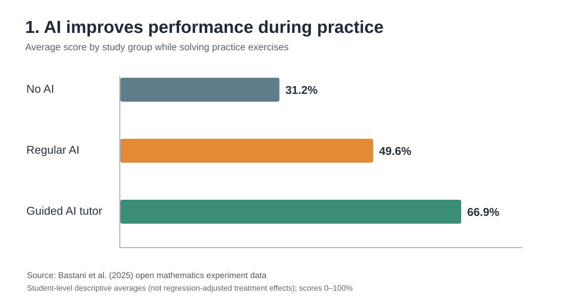
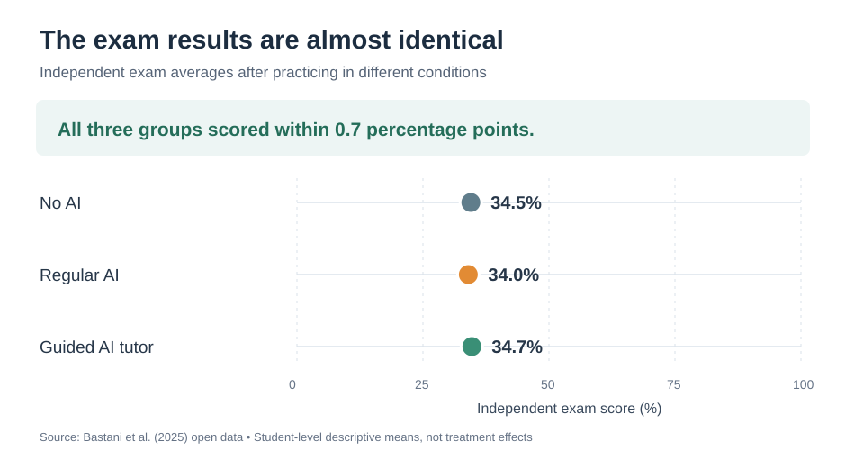
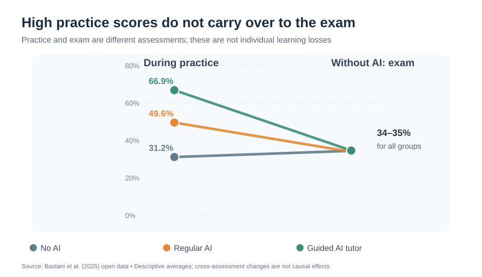

| [Home](https://jbejaran-bit.github.io/Javier_Bejarano_Telling_Stories_with_Data/) | [Part I — Proposal](final-project-part-one) | **Part II — Storyboard and research** | [Part III — Final project](final-project-part-three) |

# Final Project — Part II: Storyboard and User Research

## Does AI help students learn when they have to work without it?

**Project status:** Draft story and high-fidelity data charts prepared. **User interviews: not yet completed.** The interview findings and resulting revisions must be added after I speak with three actual people.

## 1. Draft story and storyboard

My audience is students who use AI when preparing for assignments and exams. The story has a simple question: **doing better with AI is useful, but does that translate into solving problems without it?** I will use a short scrolling presentation (planned in Shorthand), with three figures from [Bastani et al.'s mathematics experiment](https://github.com/obastani/GenAICanHarmLearning).

The opening is a **hypothetical** scenario: a student has one hour to study and can ask AI for answers, use it as a tutor, or work independently. This illustration is not part of the experiment and will not be presented as measured evidence.

### Story sequence

| Chapter | What the reader sees | What the reader should understand |
| --- | --- | --- |
| **1. The choice** | A question about how to use AI when studying | Completing practice faster is not necessarily the same as learning |
| **2. The promise** | Practice scores for three randomly assigned study groups | Students working with AI scored higher during assisted practice in these descriptive data |
| **3. The surprise** | Independent exam scores for those same groups | The large practice gap is not visible in the unassisted exam averages |
| **4. What matters** | Practice and independent scores together | The type of assistance and the outcome measured both matter; avoid universal claims |
| **5. Takeaway** | A short decision guide | Use AI as support while checking whether you can solve new problems without it |

### Chapter 1 — The study decision

**Suggested Shorthand opening:** *You have an hour to study. An AI tool could help you finish the practice problems quickly. But what happens on the exam, when the tool is gone?*

I will use a short paragraph and the original opening wireframe from [Part I](final-project-part-one), not a new dataset or an invented numerical comparison.

### Chapter 2 — Practice looks promising

**Draft caption:** In the released data, the average practice scores are about **31.2% without AI, 49.6% with regular AI, and 66.9% with a guided AI tutor**. This chart measures performance during practice; it does not by itself establish independent learning.

**Design:** Horizontal bars let readers compare three groups quickly; each group has a distinct, consistent color, direct percentage labels, and a source note.

### Chapter 3 — Take away the AI

**Draft caption:** On an independent exam, the descriptive averages are much closer: **34.5% without AI, 33.9% with regular AI, and 34.7% with a guided AI tutor**. This contrast is the turning point of my story.

**Design:** I switched to a dot plot because the three exam scores are nearly identical. A short annotation highlights that all three group averages are within one percentage point; the axis still runs from 0% to 100%.

### Chapter 4 — Compare the two outcomes

**Draft caption:** Comparing practice and exam scores helps distinguish **assisted performance** from **performance without AI**. The paired bars show the difference for each group. Because the two assessments are not necessarily equivalent in difficulty, the height difference should **not** be described as a measured loss of learning or as a causal effect.

**Design:** I switched to a slope chart to show how the two assessment averages compare for each study group. The three lines retain consistent group colors. The slopes are **not** estimates of within-student learning loss, since practice and exam are different assessments.

### Chapter 5 — The ending

**Suggested Shorthand conclusion:** *AI may help you work through practice problems, but the real test is what you can do when the assistance is removed. After using an AI explanation, try a new problem without it.*

This is a practical study suggestion, **not a tested claim that a particular amount of time with AI is optimal**. I will keep the conclusion short and mention the limits of generalizing from one school mathematics experiment to all college courses.

**Draft format:** Five scrolling sections, three main charts, and short transitions. I do not plan a dashboard, additional required datasets, or complicated interactive controls.

## 2. Data and chart development

The three visualizations above are **actual draft charts produced from research data**, not imaginary bar heights or Tableau screenshots. I deliberately use **three distinct forms**—bar chart, dot plot, and slope chart—so the reader sees the promise during practice, the near-equal exam outcomes, and the comparison as separate visual moments. I used the [public experiment file](https://raw.githubusercontent.com/obastani/GenAICanHarmLearning/main/main_regressions/final_data.csv) and a [student-level working CSV](data/ai-math-tableau-student-summary.csv). The working file contains **943 unique student records** and groups students by no AI, regular AI, or guided AI tutoring.

To avoid counting students with multiple session rows repeatedly, I first averaged available practice and exam session scores **within each student**, then averaged those scores **within each group**. These are **unadjusted descriptive averages**, and they should not be confused with the study's published regression-adjusted estimates. The full paper is the appropriate source for its inferential and causal conclusions.

The draft charts use clear titles, readable percentage labels, two outcome measures, and source credits. For Part III I will review axis scaling, accessibility, the contrast between study conditions, and whether tooltips add genuine context. The final story may rebuild the figures in Tableau and embed them in Shorthand.

## 3. User research protocol

### Goal and intended audience

I want to find out whether students can understand the difference between **getting answers with AI** and **learning to solve problems without AI**. I also want to test whether the charts and the flow of the story are clear without needing a detailed explanation from me.

### Recruitment plan

I will ask **at least three people** who broadly represent the audience: students who sometimes use AI for coursework and, if available, one student who uses it rarely. I will aim for different levels of familiarity with AI and data charts. I will interview them individually for about **5–10 minutes** and record their reactions without collecting names, contact information, or other identifying details. Participation is voluntary.

### Interview script

**Opening:** “I am creating a short data story about AI and studying. I would like your feedback on the early draft, not on your knowledge of statistics. You can be critical. I will report your feedback anonymously.”

1. Before seeing the charts, **what would you expect to happen** to students' exam performance after practicing with AI?
2. After viewing the **practice chart**, what do you think it shows? Is any label or term confusing?
3. After viewing the **independent exam chart**, what surprised you? What do the percentages mean to you?
4. Looking at the **comparison chart**, can you explain the main takeaway in your own words?
5. Is there any point where you **lose track of the story**, or where a chart or paragraph needs more context?
6. What **one thing should I change** before presenting this to other students?

**Optional follow-up prompts:** “What made you think that?” “Which chart is easiest to understand?” “Would the conclusion make you change anything about how you study?”

I will show the same draft sequence to every participant, let them speak before explaining the intended message, and take short anonymous notes. I will not suggest answers or treat feedback as research evidence about the effectiveness of AI.

## 4. Interview findings — to complete after three actual interviews

**No interviews have been reported or documented yet.** The table below is a recording sheet, not invented research findings. I will add actual anonymous comments and short verbatim quotes after each conversation.

| Feedback topic | Interview 1 | Interview 2 | Interview 3 |
| --- | --- | --- | --- |
| Participant description (general only) | Not yet interviewed | Not yet interviewed | Not yet interviewed |
| Interpretation of practice chart | Pending | Pending | Pending |
| Interpretation of exam chart | Pending | Pending | Pending |
| Confusing labels or story transitions | Pending | Pending | Pending |
| Most useful suggested change | Pending | Pending | Pending |
| Short anonymous quote (if consented) | Pending | Pending | Pending |

### Research synthesis — pending

After at least three interviews, I will identify which observations are repeated, which differ, and what changes the feedback supports. I will distinguish what participants **actually said** from my own interpretation. I will remove all personally identifiable information before publishing.

## 5. Proposed improvements for Part III

These are **initial design priorities based on reviewing the draft**, **not interview findings**. I will revise them after I receive genuine feedback.

| Design question to test | Possible improvement if interviews support it |
| --- | --- |
| Do readers understand “practice” vs. “independent exam”? | Add an explanatory subtitle before the second chart |
| Can readers interpret the percentages quickly? | Keep direct labels, add a one-line definition of what the scores measure |
| Does the slope chart feel clear or misleading? | Add explanation of assessment differences, simplify endpoint labels, or replace it if readers misinterpret it |
| Is the conclusion too strong? | Make clear that the charts show descriptive averages and the study is not universal |
| Is the student scenario mistaken for a real participant? | Clearly mark it **hypothetical** in the opening |

## 6. References and transparency

- Bastani, O., et al. (2025). [*Generative AI without guardrails can harm learning*](https://doi.org/10.1073/pnas.2422633122). *Proceedings of the National Academy of Sciences*. [Public study data](https://github.com/obastani/GenAICanHarmLearning).
- [Part I proposal and sketches](final-project-part-one) and [working student-level CSV](data/ai-math-tableau-student-summary.csv).

**AI acknowledgment:** I used ChatGPT to help organize the draft story and user-research protocol, prepare the descriptive student-level dataset and preliminary chart graphics, and edit the text on this page. I am responsible for checking the analysis, carrying out the actual user interviews, drawing conclusions from the feedback, and completing the final design. The draft charts are generated graphics based on data, **not Tableau-created figures**. No interviews or feedback were generated by AI.

